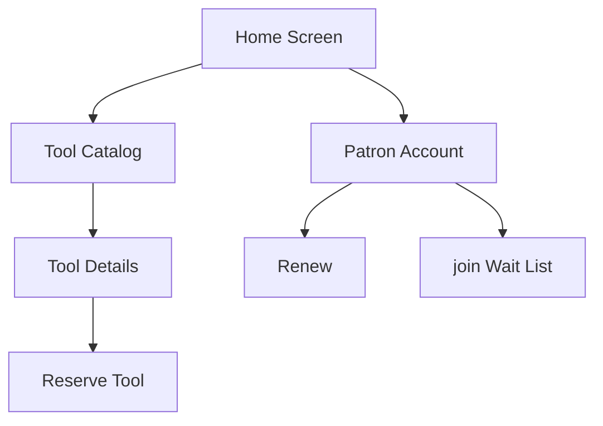
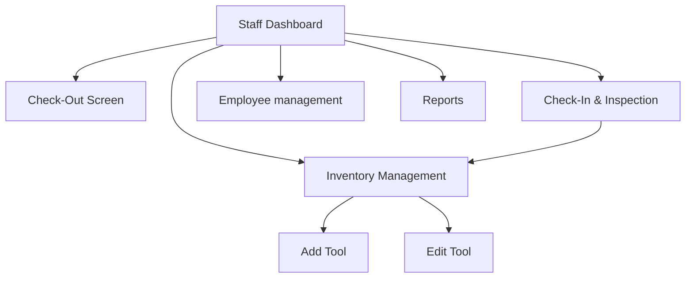

### Kate and Yaremi 
### Software Engineering 1
### Fall 2026
### Week 8 Project

# Overview
The county library is opening a Tool Library at a separate location, where patrons can borrow tools and kits the same way they borrow books. Tools are not tracked at all today, so this system will be the library's first record of what tools it owns, what condition they are in, and who has them.

The Tool Library system will let:

Patrons search the tool catalog, see whether a tool is available, join a wait list for a tool, and renew a loan.
Clerks check tools out and in, inspect returned tools, and issue new library cards.
Catalogers do everything a Clerk can, plus add, edit, and remove inventory.
Managers do everything a Cataloger can, plus manage employee accounts and roles and view reports.

Key rules the system enforces:

- Only adult residents with a valid county library card may borrow. Cards are checked through the library's existing card - verification API; the system does not keep its own separate card list.
- A patron must accept the electronic waiver once before their first loan. The waiver does not expire, but if the library - publishes a new waiver, patrons are prompted to accept it again before borrowing.
- A patron may have up to 5 tool loans at a time. This limit is separate from the book limit.
- Loans last up to two weeks; some items have shorter loan periods. A loan may be renewed once, for the same length as the original loan.
- An item is either a single tool or a kit, and a kit counts as one item. Clerks check that every component of a kit is present when it comes back.
- Returned tools must be inspected before they can be borrowed again, and are marked Ready to Borrow or In Maintenance. Any employee can flag a tool as broken, missing, or damaged.
- When a patron reaches the front of a wait list, they have 3 days to pick up the tool before it passes to the next patron. Patrons can cancel a wait list request at any time.
- Late fees start after a one-day grace period (or until closing on the next open day): $1/day for standard tools and $3/day for high-demand or large tools. Fees per item are capped at the tool's replacement value or $20, whichever is lower. -Fees are tracked by the system and paid in person.

## Integration and constraints:

The system is separate from the book loan system, but uses the same library card and card verification API.
Notifications (due date reminders, overdue notices, wait list alerts) are sent by text or email through the library's existing notification system.
The library's current spreadsheet of owned and wanted tools will be imported as the starting inventory.
There is only one location today, but the data model must support multiple lending locations in the future.

# User scenarios

## Scenario 1: Maria borrows a pressure washer for the first time

Maria wants to clean her deck this weekend. At home, she opens the Tool Catalog and searches "pressure washer." She sees that one is Ready to Borrow and that it is a high-demand tool with a one-week loan period.

At the Tool Library, she hands her county library card to Sam, the Clerk. Sam scans it, and the system checks it with the card verification API. Because this is Maria's first tool loan, the system asks her to read and accept the electronic waiver, which she does on the counter tablet. The system confirms she is an adult resident with no active tool loans, calculates a due date one week out, and Sam confirms the checkout. Maria gets an email with her due date.

## Scenario 2: Devon joins a wait list for a tile saw

Devon is retiling a bathroom and searches for a tile saw. The only tile saw is checked out, so the Tool Details page shows Join Wait List. Devon joins and is told he is second in line.

When the tile saw is returned, inspected, and marked Ready to Borrow, the patron ahead of Devon gets a text saying they have 3 days to pick it up. That patron never comes in, so after 3 days the system moves Devon to the front and sends him a text. Devon picks it up the next day. If Devon had finished his project early, he could have canceled his wait list request from his Patron Account at any time.

## Scenario 3: Priya renews a drill kit

Priya borrowed a cordless drill kit for two weeks, but her shelving project is taking longer than planned. Two days before it is due, she gets a reminder email. She opens her Patron Account, selects the drill kit, and chooses Renew. Nobody is waiting for the kit, so the system extends the loan by another two weeks and shows the new due date. The Renew option no longer appears for that loan, because each loan can only be renewed once.

# Non-goals

- Online payments. Fees are calculated and tracked, but payment is collected in person. An online payment option is a possible future feature, but integrating with the existing book payment system is not part of this project.
- Book loans. The system does not manage, replace, or combine with the book loan system. Book and tool limits are tracked separately.
- Replacing the card or notification systems. The system uses the existing card verification API and the existing text/email notification system; it does not build its own.
- Multiple locations at launch. The design allows for more locations later, but only one location will be supported in this version (no transfers between branches, per-location inventory screens, etc.).
- Tool training or certification. No training or safety courses are required to borrow, so the system will not track them.
- Borrowing by minors or non-residents. The system will not support exceptions, guardian approval, or guest borrowing.
- Tracking kit components as separate items. A kit is one item. The system records what a kit contains, but does not loan or track individual parts separately.
- Repair and maintenance management. The system records that a tool is In Maintenance, but does not track repair work orders, vendors, or repair costs.
- Purchasing. The imported "wanted tools" list is for reference only; the system does not handle ordering or buying tools.
- Delivery or pickup scheduling. Patrons pick up and return tools in person at the Tool Library.

# Use case diagrams
```mermaid
usecase-beta
actor Patron
actor Clerk
actor Cataloger
actor Manager

SearchTools("Search Tools")
ViewDetails("View Tool Details")
ReserveTool("Reserve Tool")
JoinWaitlist("Join Wait List")
RenewLoan("Renew Loan")

CheckoutTool("Check Out Tool")
CheckinTool("Check In Tool")
InspectTool("Inspect Returned Tool")
IssueCard("Issue Library Card")

ManageInventory("Manage Inventory")
ManageEmployees("Manage Employees")
ViewReports("View Reports")

Patron --> SearchTools
Patron --> ViewDetails
Patron --> ReserveTool
Patron --> JoinWaitlist
Patron --> RenewLoan

Clerk --> CheckoutTool
Clerk --> CheckinTool
Clerk --> InspectTool
Clerk --> IssueCard

Cataloger --> CheckoutTool
Cataloger --> CheckinTool
Cataloger --> InspectTool
Cataloger --> IssueCard
Cataloger --> ManageInventory

Manager --> CheckoutTool
Manager --> CheckinTool
Manager --> InspectTool
Manager --> IssueCard
Manager --> ManageInventory
Manager --> ManageEmployees
Manager --> ViewReports
```

# Use cases  
### Search for a Tool

**Actor:** Patron

**Goal:** Find a tool in the library catalog.

**Preconditions:**
- Patron has access to the Tool Library system.

**Main Flow:**
1. Patron opens the Tool Catalog.
2. Patron enters a search term or selects a category.
3. System searches the inventory.
4. System displays matching tools.
5. Patron selects a tool to view additional details.

**Alternative Flow:**
1. No matching tools are found.
2. System displays a message indicating that no results were found.

**Postconditions:**
- Patron views a list of matching tools or receives a no-results message.
-----------

### Reserve tool
**Actor:** Clerk

**Preconditions:**
- Patron has a valid library card.
- Patron has accepted the waiver.
- Patron has fewer than five active tool loans.

**Main Flow:**
1. Clerk scans the patron's library card.
2. System verifies patron eligibility.
3. Clerk selects one or more tools.
4. System calculates due dates.
5. Clerk confirms checkout.
6. System records the loan.

**Postconditions:**
- Tool is marked as checked out.
- Loan record is created.
-----------

### Return and Inspect a Tool

**Actor:** Clerk

**Preconditions:**
- Tool is currently checked out.

**Main Flow:**
1. Clerk receives returned tool.
2. System locates active loan.
3. Clerk inspects tool condition.
4. Clerk marks tool as Ready to Borrow or In Maintenance.
5. System updates inventory status.

**Postconditions:**
- Tool is returned and inventory updated.

-------------
### Manage Inventory

**Actor:** Cataloger

**Preconditions:**
- User is logged in as a Cataloger or Manager.

**Main Flow:**
1. User opens Inventory Management.
2. User adds, edits, or removes an item.
3. System validates information.
4. System saves changes.

**Postconditions:**
- Inventory records are updated.

------------------
### Manage Employees

**Actor:** Manager

**Preconditions:**
- User is logged in as a Manager.

**Main Flow:**
1. Manager opens Employee Management.
2. Manager selects an employee.
3. Manager changes roles or account status.
4. System saves changes.

**Postconditions:**
- Employee permissions are updated.

---------------
# UX flow


# User screens
_Patron_



_Staff_  

