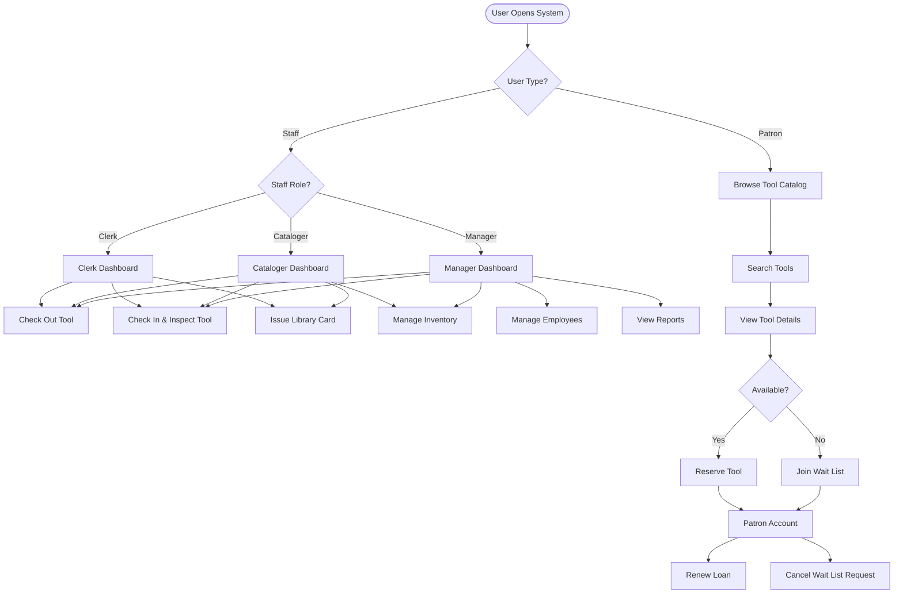
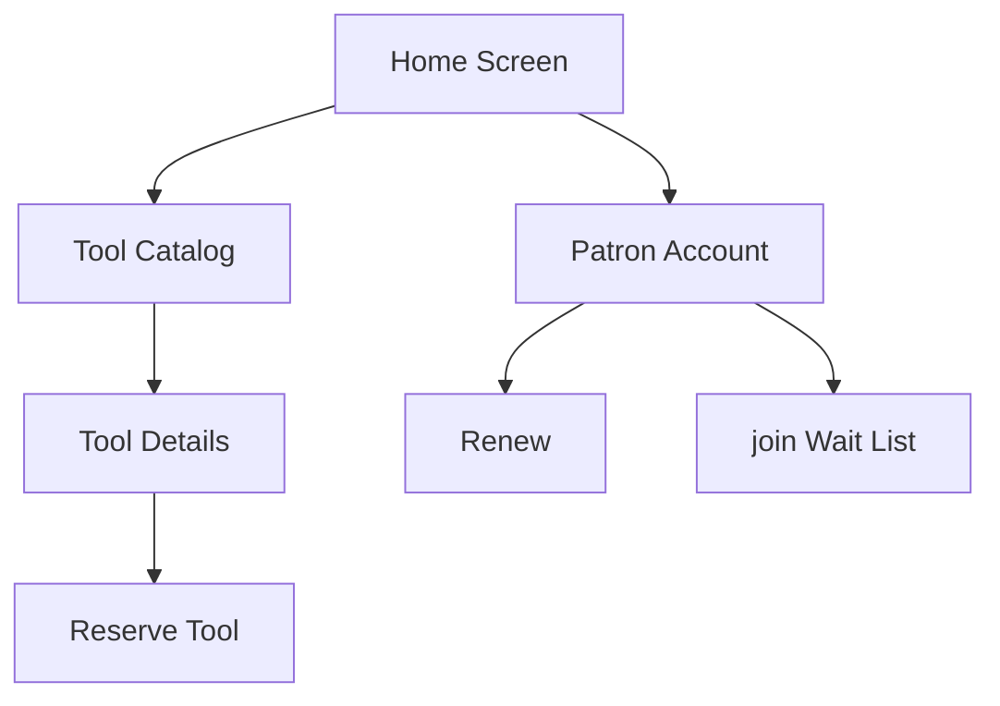
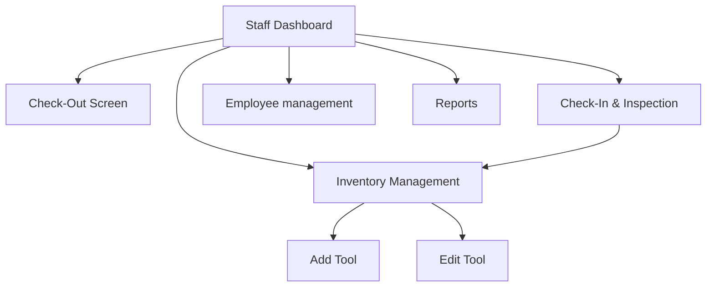

### Kate and Yaremi 
### Software Engineering 1
### Fall 2026
### Week 8 Project

# Overview
# User scenarios
# Non-goals
# Use case diagrams
```mermaid
usecase-beta
actor Patron
actor Clerk
actor Cataloger
actor Manager

SearchTools("Search Tools")
ViewDetails("View Tool Details")
ReserveTool("Reserve Tool")
JoinWaitlist("Join Wait List")
RenewLoan("Renew Loan")

CheckoutTool("Check Out Tool")
CheckinTool("Check In Tool")
InspectTool("Inspect Returned Tool")
IssueCard("Issue Library Card")

ManageInventory("Manage Inventory")
ManageEmployees("Manage Employees")
ViewReports("View Reports")

Patron --> SearchTools
Patron --> ViewDetails
Patron --> ReserveTool
Patron --> JoinWaitlist
Patron --> RenewLoan

Clerk --> CheckoutTool
Clerk --> CheckinTool
Clerk --> InspectTool
Clerk --> IssueCard

Cataloger --> CheckoutTool
Cataloger --> CheckinTool
Cataloger --> InspectTool
Cataloger --> IssueCard
Cataloger --> ManageInventory

Manager --> CheckoutTool
Manager --> CheckinTool
Manager --> InspectTool
Manager --> IssueCard
Manager --> ManageInventory
Manager --> ManageEmployees
Manager --> ViewReports
```

# Use cases  
### Search for a Tool

**Actor:** Patron

**Goal:** Find a tool in the library catalog.

**Preconditions:**
- Patron has access to the Tool Library system.

**Main Flow:**
1. Patron opens the Tool Catalog.
2. Patron enters a search term or selects a category.
3. System searches the inventory.
4. System displays matching tools.
5. Patron selects a tool to view additional details.

**Alternative Flow:**
1. No matching tools are found.
2. System displays a message indicating that no results were found.

**Postconditions:**
- Patron views a list of matching tools or receives a no-results message.
-----------

### Reserve tool
**Actor:** Clerk

**Preconditions:**
- Patron has a valid library card.
- Patron has accepted the waiver.
- Patron has fewer than five active tool loans.

**Main Flow:**
1. Clerk scans the patron's library card.
2. System verifies patron eligibility.
3. Clerk selects one or more tools.
4. System calculates due dates.
5. Clerk confirms checkout.
6. System records the loan.

**Postconditions:**
- Tool is marked as checked out.
- Loan record is created.
-----------

### Return and Inspect a Tool

**Actor:** Clerk

**Preconditions:**
- Tool is currently checked out.

**Main Flow:**
1. Clerk receives returned tool.
2. System locates active loan.
3. Clerk inspects tool condition.
4. Clerk marks tool as Ready to Borrow or In Maintenance.
5. System updates inventory status.

**Postconditions:**
- Tool is returned and inventory updated.

-------------
### Manage Inventory

**Actor:** Cataloger

**Preconditions:**
- User is logged in as a Cataloger or Manager.

**Main Flow:**
1. User opens Inventory Management.
2. User adds, edits, or removes an item.
3. System validates information.
4. System saves changes.

**Postconditions:**
- Inventory records are updated.

------------------
### Manage Employees

**Actor:** Manager

**Preconditions:**
- User is logged in as a Manager.

**Main Flow:**
1. Manager opens Employee Management.
2. Manager selects an employee.
3. Manager changes roles or account status.
4. System saves changes.

**Postconditions:**
- Employee permissions are updated.

---------------
# UX flow



# User screens
_Patron_



_Staff_  

